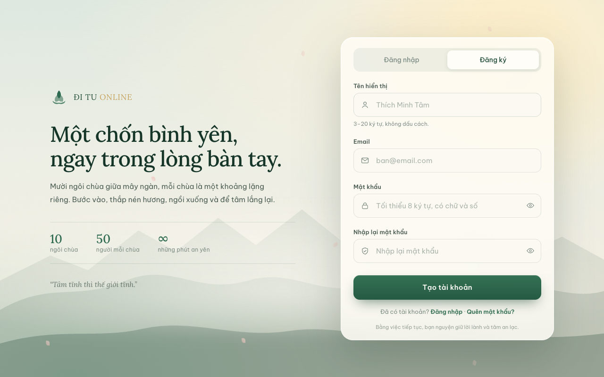
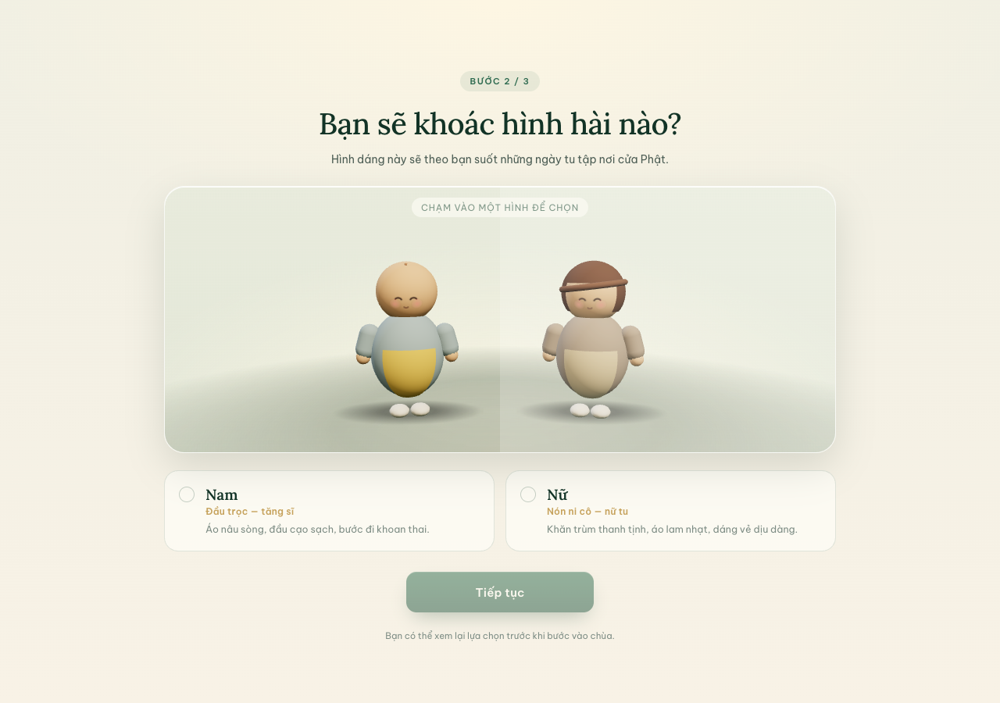
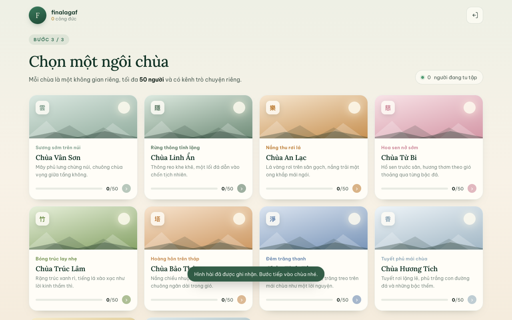
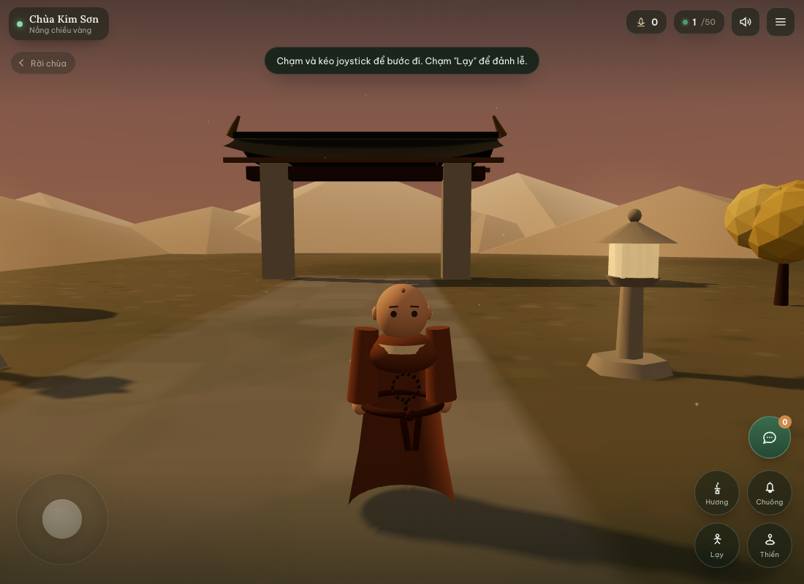

# Đi Tu Online 🪷

Game **đi tu trực tuyến** nhiều người chơi, lấy cảm hứng từ [sansatemple.com](https://sansatemple.com/):
bước vào một ngôi chùa 3D yên tĩnh, đi dạo trong sân, lạy Phật, ngồi thiền, thỉnh chuông và trò chuyện
cùng những người tu tập khác.

Có **10 ngôi chùa**, mỗi chùa tối đa **50 người** và có **kênh chat riêng**.

---

## Tính năng

| Nhóm | Chi tiết |
| --- | --- |
| Tài khoản | Đăng ký (tên hiển thị, email, mật khẩu, nhập lại mật khẩu), đăng nhập, quên/đặt lại mật khẩu, ghi nhớ phiên |
| Giới tính | Màn hình chọn **Nam (đầu trọc)** hoặc **Nữ (nón ni cô)**, xem trước 3D, popup xác nhận trước khi vào chùa |
| Thế giới | 10 chùa với 10 bảng màu/thời tiết khác nhau (sương sớm, lá thu, hoa sen, tuyết, đêm trăng, mưa xuân…) |
| Nhiều người | Đồng bộ vị trí, hướng đi, tư thế ngồi thiền, lạy, dâng hương; hiển thị tên và bong bóng chat trên đầu nhân vật |
| Giới hạn | Mỗi chùa **50 chỗ**, server chặn người thứ 51, danh sách chùa cập nhật số người theo thời gian thực |
| Chat | Kênh riêng từng chùa, lưu 40 tin gần nhất, chống spam (tối đa 6 tin/10 giây), hiển thị "đang nhập…" |
| Sinh hoạt | 2 NPC (một tăng sĩ, một ni cô) cầm chổi đi qua lại quét sân; 2 con mèo đi dạo trong sân |
| Tu tập | Lạy (+1 công đức), dâng hương (+3), thỉnh chuông (+2), thiền định có hào quang và đệm ngồi |
| Âm thanh | Gió, chim hót, chuông chùa, bước chân — tổng hợp bằng WebAudio, không cần file âm thanh |
| Quảng cáo | Banner AdMob cố định ở mép dưới màn đăng nhập, đăng ký và chọn chùa (ẩn khi vào trong chùa) |
| Android | Đóng gói bằng Capacitor, icon và splash riêng, hỗ trợ nhập địa chỉ máy chủ LAN |

---

## Kiến trúc

```
client/            Giao diện + game 3D (Vite + Three.js, JavaScript thuần)
  index.html
  src/
    main.js        Điều hướng màn hình, luồng đăng nhập → giới tính → chọn chùa → game
    ads.js         Banner AdMob: hiện/ẩn theo màn hình, chừa khoảng trống mép dưới
    ui/            Đăng ký/đăng nhập, chọn giới tính (3D preview), chọn chùa, modal, toast
    game/          Three.js: thế giới chùa, nhân vật, điều khiển, âm thanh, vòng lặp game
shared/temples.js  Dữ liệu 10 chùa dùng chung cho server và client
server/            Express + Socket.IO + SQLite (node:sqlite)
  index.js         REST API + phục vụ bản build
  sockets.js       Phòng theo chùa, đồng bộ người chơi, chat, công đức
  auth.js          scrypt, token HMAC, kiểm tra dữ liệu
  db.js            Lược đồ SQLite
android/           Dự án Android (Capacitor)
```

- **Mật khẩu** băm bằng `scrypt` (salt ngẫu nhiên 16 byte).
- **Phiên đăng nhập** là token HMAC-SHA256 hết hạn sau 30 ngày.
- **Vị trí** được server kẹp trong biên thế giới để chống di chuyển bất thường.
- **Chat** lưu trong SQLite, mỗi chùa một kênh.
- Máy chủ chỉ dùng **thư viện thuần JS** (SQLite có sẵn trong Node ≥ 22.5).

---

## Yêu cầu

- **Node.js ≥ 22.5** (do dùng `node:sqlite`)
- Trình duyệt hiện đại (Chrome/Edge/Safari/Firefox)
- Để build APK: **JDK 17+**, **Android SDK** (build-tools + platform 36)

---

## Chạy ở chế độ phát triển

```bash
npm install
npm run dev
```

- Giao diện: <http://localhost:5173>
- API/socket: <http://localhost:3000> (Vite tự proxy)

## Chạy bản production (web)

```bash
npm run build     # build client vào server/public
npm start         # http://localhost:3000
```

Mở `http://<IP-máy-tính>:3000` từ điện thoại cùng mạng Wi-Fi để chơi thử.

---

## Build APK Android

```bash
npm run android:apk
```

APK được lưu tự động vào thư mục [`build/`](build/) với tên có phiên bản và thời điểm,
ví dụ `build/DiTuOnline-v1.0.0-20261106-1648-debug.apk` (xem [build/versions.md](build/versions.md)).
Bản gốc do Gradle tạo nằm ở `android/app/build/outputs/apk/debug/app-debug.apk`.

Có thể build bản release (cần cấu hình khoá ký trong `android/app/build.gradle`):

```bash
npm run android:bundle
```

### Kết nối tới máy chủ

App **không** chạy server bên trong — điện thoại cần trỏ tới máy tính/ máy chủ đang chạy `npm start`.

1. Mở app → màn hình đăng nhập có nút **“Máy chủ”** ở cạnh dưới.
2. Nhập địa chỉ, ví dụ `http://192.168.1.10:3000` (cùng mạng Wi-Fi) hoặc `http://10.0.2.2:3000` (giả lập Android).
3. Bấm **Lưu & tải lại**.

Địa chỉ được lưu lại cho các lần mở sau. Có thể đặt mặc định khi build:

```bash
VITE_DEFAULT_SERVER=http://192.168.1.10:3000 npm run android:apk
```

> Lưu ý: `usesCleartextTraffic` đã bật để dùng HTTP trong mạng nội bộ. Khi triển khai thật, hãy dùng HTTPS
> và đặt sau Nginx/Caddy.

---

## Chơi với bạn bè qua Internet (nhanh nhất)

```bash
npm run public
```

Lệnh này chạy server + Cloudflare Quick Tunnel, in ra địa chỉ dạng
`https://....trycloudflare.com`. Gửi địa chỉ đó cho bạn bè, hoặc nhập vào app Android ở nút **Máy chủ**.

- Máy tính phải đang bật và kết nối Internet.
- Địa chỉ **đổi mỗi lần chạy**.
- Cần `bin/cloudflared` — tải một lần theo hướng dẫn trong [docs/DEPLOY.md](docs/DEPLOY.md).

Với địa chỉ cố định, dùng Render hoặc VPS (xem [docs/DEPLOY.md](docs/DEPLOY.md)).

---

## Hòm công đức

- Nút **hòm công đức** ở màn chọn chùa (biểu tượng hộp quà vàng) và trong menu **Tĩnh tâm** khi đang chơi.
- Số Momo cấu hình tại `client/src/config.js` (`MOMO_NUMBER`).
- Muốn hiện **mã QR Momo** trong popup: mở app Momo → *Nhận tiền* → lưu mã QR của bạn,
  đặt tên `momo-qr.png` và để vào `client/public/momo-qr.png`, rồi build lại.
  Nếu chưa có ảnh, popup vẫn hiện số Momo và nút sao chép.

---

## Quảng cáo (AdMob)

Banner quảng cáo nằm **cố định ở mép dưới** ba màn hình: đăng nhập, đăng ký (cùng màn `auth`)
và chọn chùa. Banner do SDK AdMob vẽ đè lên WebView, giao diện tự chừa khoảng trống qua biến
CSS `--ad-h` nên nội dung không bị che.

- Plugin: `@capacitor-community/admob` — logic ở [`client/src/ads.js`](client/src/ads.js)
- App ID: `android/app/src/main/AndroidManifest.xml`
- Banner ad unit ID: hằng `BANNER_AD_ID` trong `client/src/ads.js`

Hiện dùng **quảng cáo thử nghiệm của Google** (`TESTING = true`). Khi phát hành thật:

1. Tạo ứng dụng + banner trong [AdMob](https://admob.google.com/).
2. Thay `com.google.android.gms.ads.APPLICATION_ID` trong `AndroidManifest.xml` bằng App ID thật.
3. Thay `BANNER_AD_ID` và đặt `TESTING = false` trong `client/src/ads.js`.
4. Nếu phát hành ở EU, bổ sung luồng consent UMP của plugin trước khi gọi `showBanner`.
5. Build lại APK — banner chỉ có trong app Android, bản web không hiện quảng cáo.

---

## Triển khai lên Internet

Hướng dẫn chi tiết cho Render (miễn phí), Cloudflare Tunnel và VPS Oracle:
xem [docs/DEPLOY.md](docs/DEPLOY.md).
Riêng Oracle Always Free (miễn phí vĩnh viễn, có ổ đĩa giữ dữ liệu):
xem [docs/DEPLOY-ORACLE.md](docs/DEPLOY-ORACLE.md).

Bản deploy sẵn có: [`render.yaml`](render.yaml), [`Dockerfile`](Dockerfile).

---

## Cấu hình

| Biến môi trường | Mặc định | Ý nghĩa |
| --- | --- | --- |
| `PORT` | `3000` | Cổng máy chủ |
| `HOST` | `0.0.0.0` | Địa chỉ lắng nghe |
| `DATA_DIR` | `./data` | Thư mục chứa SQLite và khoá bí mật |
| `AUTH_SECRET` | tự sinh | Khoá ký token |
| `PUBLIC_URL` | tự suy ra | Gốc URL dùng trong email đặt lại mật khẩu |
| `SMTP_*`, `MAIL_FROM` | — | Gửi email quên mật khẩu; nếu bỏ trống, liên kết được in ra console |

Khi chưa cấu hình SMTP, màn hình “Quên mật khẩu” sẽ hiện nút **Đặt lại mật khẩu ngay** (chỉ ở chế độ dev)
và liên kết cũng được in trong log máy chủ.

---

## API chính

| Phương thức | Đường dẫn | Mô tả |
| --- | --- | --- |
| POST | `/api/auth/register` | Đăng ký |
| POST | `/api/auth/login` | Đăng nhập (email hoặc tên) |
| GET | `/api/auth/me` | Thông tin tài khoản |
| POST | `/api/auth/gender` | Lưu giới tính (`male`/`female`) |
| POST | `/api/auth/forgot` | Gửi liên kết đặt lại mật khẩu |
| POST | `/api/auth/reset` | Đặt mật khẩu mới |
| GET | `/api/temples` | Danh sách 10 chùa kèm số người |
| GET | `/api/health` | Kiểm tra máy chủ |

Sự kiện Socket.IO: `join`, `leave`, `move`, `action`, `chat`, `typing` → `player:join`, `player:leave`,
`player:move`, `player:action`, `chat:message`, `temple:count`, `temple:counts`, `merit`.

---

## Kiểm thử

```bash
# kiểm tra giới hạn 50 người/chùa (cần server đang chạy)
node scripts/test-capacity.mjs
```

Script tạo 51 tài khoản tạm, cho vào cùng một chùa, xác nhận người thứ 51 bị chặn
(`TEMPLE_FULL`) và số người trở về 0 sau khi rời đi, rồi tự dọn dữ liệu test.

Các luồng đã được kiểm tra thủ công bằng trình duyệt và trên trình giả lập Android:
đăng ký → chọn giới tính → xác nhận → chọn chùa → vào chùa → chat, rời chùa và vào chùa khác,
đăng nhập cùng lúc trên hai thiết bị (phiên cũ bị đẩy ra), quên/đặt lại mật khẩu.

### Ảnh giao diện

| | |
| --- | --- |
|  |  |
|  |  |

---

## Cấu trúc dữ liệu

`data/ditu.db` (SQLite, WAL):

- `users` — tài khoản, giới tính, chùa đang trú, công đức
- `chat_messages` — tin nhắn theo chùa
- `reset_tokens` — token đặt lại mật khẩu (lưu dạng băm, hết hạn 30 phút)

Xoá `data/` để reset toàn bộ người dùng.

---

## Ghi chú & giới hạn hiện tại

- Chưa có xác thực email, chưa có tính năng bạn bè/riêng tư.
- Chat chỉ lưu 40 tin gần nhất khi vào chùa (dữ liệu vẫn nằm trong DB).
- Một tài khoản chỉ có một phiên trong chùa: đăng nhập thiết bị khác sẽ đẩy phiên cũ ra.
- Chưa có chống gian lận nâng cao (tốc độ di chuyển do client gửi).
- Âm thanh cần một lần chạm (chính sách autoplay của trình duyệt).

## Hướng phát triển

- Thêm nghi lễ: tụng kinh, cúng dường, lịch âm, thời khoá biểu.
- Thêm vật phẩm/trang phục và hệ thống công đức mở khoá.
- Âm thanh vị trí (spatial audio) và nhạc nền theo từng chùa.
- Hệ thống bạn bè, thiền cùng nhau theo nhóm.
- Triển khai HTTPS + CDN, giám sát và sao lưu SQLite định kỳ.

---

Made with 🪷 — chúc bạn một ngày an lạc.
